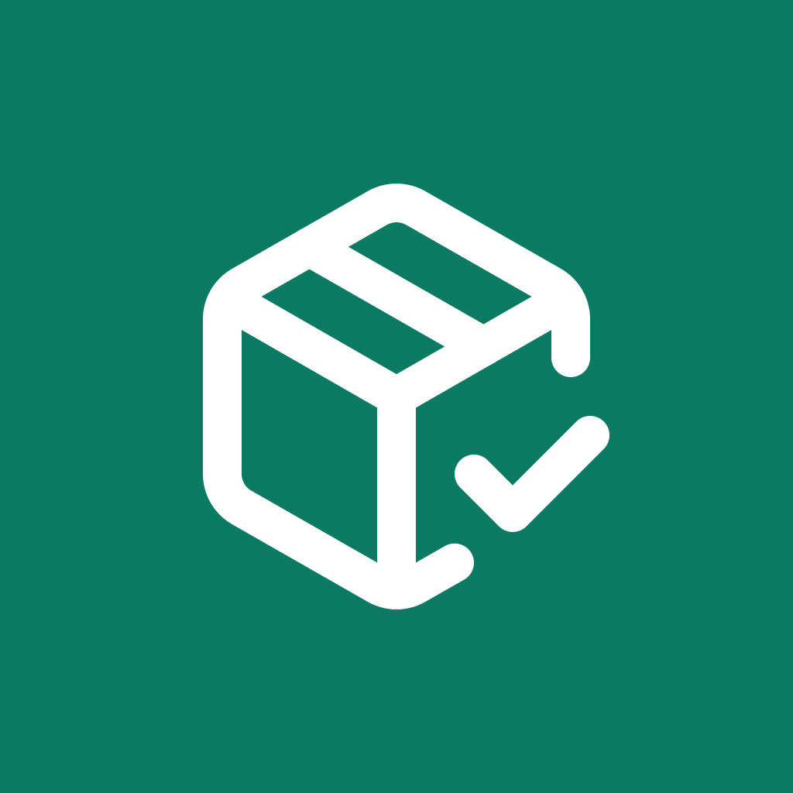

# Doorstep

Pay a shop with any crypto, from any chain. The money waits in a NEAR smart
contract and reaches the shop only when delivery is proven. If delivery isn't
proven by the deadline, the buyer is refunded automatically. If something goes
wrong after delivery, the buyer can complain within a set time window, and the
contract owner decides who gets the money.

- **Hosted demo (demo mode, no real money):** https://doorstep-iug1.vercel.app
  (mirror: https://doorstep-near.onrender.com)
- **Demo video:** _link added at submission_
- Built at **NEAR HACKATHON** (19 Oct to 14 Nov 2026) for the Real-World Money and Open Innovation tracks. All code was written during the hackathon; the first commit is 12 Nov 2026.

## The problem

A crypto payment to a shop is final the moment it lands. If the parcel never
arrives, getting the money back depends on the seller; there is no chargeback.
In India, where we started, this is why shops still rely on cash on delivery,
and cash-on-delivery orders are returned to the seller far more often than
prepaid ones ([Razorpay](https://razorpay.com/blog/cash-on-delivery-and-the-challenges/)).

## How it works

1. **The shop creates an order** and sends the buyer a pay link. No crypto
   knowledge is needed: a price in USDC and a deliver-by date.
2. **The buyer pays with any token on any chain.** NEAR Intents 1Click converts
   it into exactly the price in USDC and delivers it straight into the escrow
   contract, tagged with the order id. The order turns **Funded** on chain with
   no manual step. For ETH and tokens on Ethereum, Base and Arbitrum, a
   **Pay with wallet** button sends the exact amount from a browser wallet
   (MetaMask, Coinbase Wallet, Rabby, or a phone wallet's built-in browser).
   On a phone, the pay page offers to reopen itself inside MetaMask or
   Coinbase Wallet. Any other wallet or exchange can send to the deposit
   address shown.
3. **The shop hands the parcel over** (by hand, by courier, or with a tracking
   number) and marks it shipped.
4. **Delivery is proven** in one of three ways:
   - the buyer's **delivery pass QR** is scanned at the door. It carries a
     signature from a key that the buyer's browser created and holds;
   - the buyer reads out a **6-digit code**, the shop types it in, and the
     backend's checker key countersigns it;
   - a **courier webhook** (Borzo) reports the drop-off, and the checker key countersigns it.
5. **A complaint window** opens (10 minutes in our test deployment, 24 hours
   intended for real use). If the buyer doesn't complain, the backend
   **releases** the USDC to the shop.
6. **If delivery isn't proven by the deadline**, anyone can trigger a
   **refund**, and the backend's scheduler does it automatically. If the buyer
   complains inside the window, the money freezes, and the owner settles it.

Payouts and refunds are credited inside **NEAR Intents**, so the shop (or the
buyer) can withdraw to any chain from https://app.near-intents.org.

## Proven on NEAR mainnet

Real orders with real USDC. The shop account `0xeraya.near` belongs to Eraya
Foods (Delhi), who agreed to receive payments through Doorstep. These were small
test orders placed by the team, not customer traction. Orders #4 and #6 (0.20
USDC each) repeated the #2 path and are not listed; #5 was opened but never paid.

| Order | What it proves | Transactions |
| --- | --- | --- |
| **#1** (scripts, 12 Nov) | 1Click → escrow with `customRecipientMsg`; buyer-signed delivery; release into NEAR Intents | Full log in [`scripts/TEST-RESULTS.md`](scripts/TEST-RESULTS.md) |
| **#2** (app, 13 Nov), 0.20 USDC, shop `0xeraya.near` | The whole app flow: paid from Base → Funded → handed over → **6-digit code countersigned by the checker key** → released automatically after the window | [create](https://nearblocks.io/txns/AwM3vP7cM2g8qAB1wh64Y7w2ZfTwk13fTRxkC1RFiA9x) · [Base payment](https://basescan.org/tx/0x585066f748d626ecb2704fe8edb6a9b880e33f18be6bf4dfb39adee85115377a) · [funded](https://nearblocks.io/txns/6MqgmzSFGbNQvTk1g9rTvwnrE2btptC86A21zi8eb76M) · [shipped](https://nearblocks.io/txns/HmTwuwvMQg4XuBEDaxLsAD9KrxLwY9fkkXDsNck7d6Ui) · [delivered](https://nearblocks.io/txns/HJ9bBhg3aG1nJZJrvRLQaGVFPiMUq71LLhCMxuBsQ3ow) · [released](https://nearblocks.io/txns/8SKBPrKJ2cje2XMjqCzvEa3FJUuryPpcS7a4nMdb1eKv) |
| **#3** (app, 14 Nov), 1.00 USDC, shop `0xeraya.near` | **Buyer complaint inside the window** freezes the money; the **owner resolves it as a refund**; 1.00 USDC is credited back to the buyer in NEAR Intents | [create](https://nearblocks.io/txns/3wXxDRdKJHKDyBfwZVnYXXcwzmPkfU8F14x5G928bSKa) · [Base payment](https://basescan.org/tx/0xdd8e1afd1126267f32a5770d8dff7bb8b8c66e9dffd0fbe360b3f6a9b2e40f93) · [funded](https://nearblocks.io/txns/8DrdKmBeiftckPvdEDoRRemySUAmkNx3xhTF8M84StwG) · [delivered](https://nearblocks.io/txns/HBr99kyxmsctyzFgyMzePkdKjTmnyYRaMLN9DYUnXTkw) · [complaint](https://nearblocks.io/txns/9T8nVJoXi8F5dy5FHiZLfDpbzSEmVpCfmBK8zLwW6jzg) · [resolved, refunded](https://nearblocks.io/txns/BwrXwtUWTsynCAhm151kWYmNWFttPEQyxZZTLCn9ZjLf) |
| **#7** (app, 14 Nov), 2.00 USDC, shop `0xeraya.near` — the order in the demo video | The full flow, filmed: paid from Base → Funded → handed over → 6-digit code → released automatically; 14 minutes from order to shop paid | [create](https://nearblocks.io/txns/4UwYzv1X9c4BTR3fE8kK9P8nCPLuiiqar4asdj7sHCPo) · [Base payment](https://basescan.org/tx/0x943324b4e64af1e6af89c33d5603f7a1767c2eec64c05e4a1d8467ed54eb4a69) · [funded](https://nearblocks.io/txns/9mCQoenBZy6kDADQhvkmZ6y28ut1Hp17jEENNWHobA8r) · [shipped](https://nearblocks.io/txns/GggmU25yHAxe2A4DjF3KaYYStrPzL7XqHAb8iUY2FeJw) · [delivered](https://nearblocks.io/txns/7r7YRrTAv6dkRU3g97RBNvu6Hx2qQhVVTjv181cvX1eQ) · [released](https://nearblocks.io/txns/DDzh22LQSB7HGebsRXYHHnuSM2qibSoauyUJH34moGHH) |

Each release and refund transaction shows the same log sequence: the escrow
emits `order_released` or `order_refunded`, the USDC contract transfers to
`intents.near`, `intents.near` mints the amount to the recipient (`mt_mint`),
and the escrow's callback emits `payout_done`.

## Try it (free: no keys, no real money)

**Requirements:** Node.js 22.13 or newer (24 recommended; see `.node-version`).
Rust is needed only for the contract tests.

### Option A: hosted demo

1. Open https://doorstep-iug1.vercel.app. A yellow bar says
   **"Demo mode — practice only, don't send real money"**.
2. Click **Try the demo**. The seller sign-in opens. Sign in with the token
   `demo`. You see the shop **Eraya Foods (demo)** and its orders.
3. Click **New order**, fill it in, and open the **pay link** as the buyer. Pick
   a token, enter any refund address, and continue.
4. The payment screen shows a red **"Practice mode: don't send real money"**
   box and an address starting with `DEMO-NOT-REAL-`. This address is invalid
   on every chain, so no wallet can send to it.
5. Use the demo steps on the page to simulate the payment. The order moves to
   **Held safely**. Follow it through delivery from the order page and the
   seller dashboard.

The free hosting sleeps after about 15 minutes without visitors; the first visit
can take up to a minute to wake it up.

### Option B: run it locally

```bash
npm ci
npm run demo
```

You should see:

```
Doorstep API on http://localhost:8787 (DEMO MODE: fake chain, fake 1Click, mock courier, no network)
Seller token: demo
```

Open http://localhost:5173 and follow the steps of option A. In demo mode, the
API runs the contract's state machine and checks buyer and checker signatures
with real ed25519. Everything stays in memory: a restart gives you fresh sample data.

Browser-only version, with no backend at all: `npm run dev:mock`.

### Tests

```bash
npm test                 # shared 5, API 80, web 108 tests (no network)
npm run test:contract    # 49 contract unit tests (needs Rust)
```

## Run it for real (NEAR mainnet)

This moves real money. The full steps are in
[`services/api/README.md`](services/api/README.md#2-run-it-for-real-near-mainnet)
and [`scripts/README.md`](scripts/README.md). In short:

1. Deploy the escrow and register it with USDC (`scripts/deploy.sh`).
2. Copy `.env.example` to `.env`. Fill in the escrow, the shop's NEAR account,
   a long random `SELLER_TOKEN`, and the shop details.
3. Create the checker key (`node scripts/keys.mjs new --out .keys/checker.json`)
   and the relayer's limited key (`bash scripts/add-relayer-key.sh`).
4. Run `npm run dev:api` and `npm run dev:web`. The API checks the contract at
   startup and prints a warning for anything missing.

**More than one shop.** One Doorstep serves many shops on the same escrow.
Each shop has its own seller token and payout account, and sees only its own
orders. The shop from `SHOP_*` in `.env` is the first one. Add others with:

```bash
npm run merchant:add -- --id spice --name "Spice Route" --account 0xabc...
```

This writes `data/merchants.json` (git-ignored) and saves the new shop's token
to `data/merchant-tokens/<id>.txt` without printing it. Then set
`MERCHANTS_FILE=data/merchants.json` and restart the API. A payout account can
be a NEAR account or a plain `0x…` wallet address: NEAR Intents credits both
(order #3's refund went to a `0x…` account).

## How NEAR is used

| Piece | What it does in Doorstep |
| --- | --- |
| **NEAR Intents 1Click** | `EXACT_OUTPUT` quote with recipient = the escrow and `customRecipientMsg` = the order id. 1Click delivers USDC to the escrow's `ft_on_transfer`, which funds that order. The buyer can pay from any chain and token that 1Click supports. |
| **NEAR Intents balances** | Payouts and refunds use `ft_transfer_call` to `intents.near` with the recipient as `msg`, so the shop is paid inside NEAR Intents and can withdraw to any chain. |
| **Escrow contract** (Rust, near-sdk 5.30) | Holds the USDC per order and enforces the state machine: Created → Funded → Shipped → Delivered → Released, or Refunded, Disputed, Expired. See [`contracts/escrow/README.md`](contracts/escrow/README.md). |
| **On-chain ed25519 checks** | The buyer's delivery and complaint signatures and the checker's signature are verified by the contract against exact message texts. |
| **Function-call access key** | The backend's relayer key may call only the escrow's 7 order methods (`create_order`, `mark_shipped`, `confirm_by_buyer`, `confirm_by_checker`, `raise_complaint`, `release`, `refund`) and has a 1 NEAR gas allowance. It can't move funds anywhere else. |

## On chain vs off chain

- **On chain, per order:** id, shop account, price, amount paid, deadline, the
  buyer's public key and refund account, status, proof type, courier
  reference, and timestamps.
- **Off chain** (the backend's SQLite database): the item, the note, the
  buyer's phone number and the delivery address. Public pages mask the phone
  and show only the area.

## Trust model and limits

What you have to trust, stated plainly:

- **During the 1Click swap**, the money is with NEAR Intents and 1Click, not
  with our contract. If the conversion fails, 1Click refunds the buyer on the
  chain they paid from.
- **Disputes are decided by the contract owner** (`resolve`). That is a central
  point of control.
- **The checker key is held by the backend.** Proofs by 6-digit code or courier
  webhook therefore trust the backend and the courier. The owner can rotate the
  key with `set_checker_pk`.
- **Whoever holds the buyer's delivery pass can confirm delivery.** It works
  like a key: the buyer should show it only once the parcel is in their hands.
- **Payouts and refunds land in NEAR Intents balances.** To move them out, the
  recipient signs in at app.near-intents.org.
- **Demo mode and the browser sandbox** give out deposit addresses that start
  with `DEMO-NOT-REAL-` and are invalid on every chain. The pages warn in red not
  to send real money.

## Not yet run on mainnet

These paths are covered by unit tests but have not run with real money yet:

- the automatic refund after the deadline, run by the scheduler (the complaint
  and refund path above did run);
- a Borzo courier webhook (only Borzo's test environment so far);
- a shop withdrawing from NEAR Intents to another chain;
- payments in anything other than USDC on Base;
- the **Pay with wallet** button (tested against a fake wallet; it sends the
  same plain transfer as the exchange withdrawals above);
- Ship24 tracking webhooks, parked (unmatched) payments with
  `refund_unmatched`, and the `Direct` payout mode.

## Next

- **One-tap payment from NEAR wallets** (NEAR Mobile, Meteor, HOT) through
  NEAR Wallet Selector. The pay page already offers USDC, USDT and wNEAR on
  NEAR through the copy-the-address flow, but that hasn't been tested with real
  money. The button would also register the deposit address with the token and
  wrap NEAR when needed.
- **WalletConnect**, so a phone wallet can pay a page open on a laptop by
  scanning a QR code.

## Repository

| Folder | What |
| --- | --- |
| [`contracts/escrow`](contracts/escrow) | The escrow contract (Rust) and its 49 unit tests |
| [`services/api`](services/api) | Backend: orders, 1Click, relayer, checker, Borzo, scheduler (Fastify, TypeScript) |
| [`apps/web`](apps/web) | Buyer and seller pages (React) |
| [`packages/shared`](packages/shared) | The API contract as zod schemas, used by both sides |
| [`scripts`](scripts) | Deploy, test orders, the 1Click test, key tools, and the 12 Nov test results |
| [`DEPLOY.md`](DEPLOY.md) | How the hosted demo runs (Render and Vercel) |

## Libraries and AI-written code

- **Contract:** near-sdk 5.30 (Rust), and ed25519-dalek for tests.
- **Backend:** Fastify 5, @fastify/cors, near-api-js 5, zod 4, Node's built-in
  `node:sqlite`, and tsx.
- **Web:** React 19, React Router 7, TanStack Query 5, Tailwind CSS 4, Vite 7,
  @noble/ed25519, @noble/hashes, qrcode, qr-scanner and lucide-react.
- **Tests:** Vitest and Testing Library.
- **Outside services:** NEAR Intents 1Click API, NEAR RPC, Borzo (courier, test
  environment), and Render and Vercel (hosting).

This project was built with an AI coding assistant (Claude Code). The team set
the design, reviewed the code, and ran every mainnet test above.

## License

[MIT](LICENSE)
